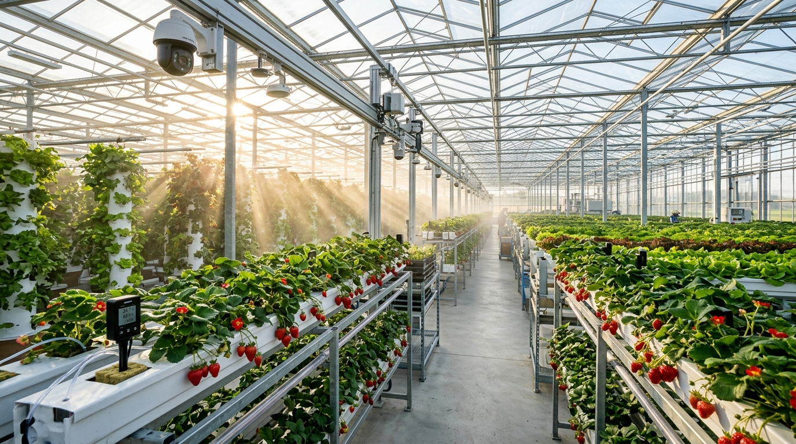
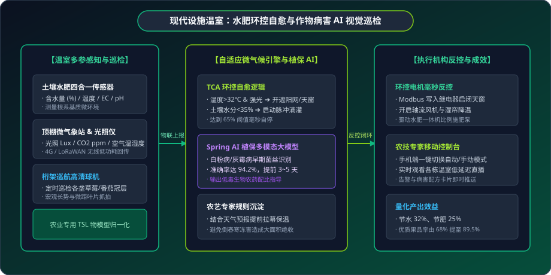

# 🌱 智慧农业落地案例：现代设施温室水肥环控自愈与病虫害 AI 识别

> **场景标签**：LoRaWAN/Modbus 物联感知 · 设施温室微气候调控 · 水肥一体化反控 · GB28181 云台巡检 · Spring AI 植保视觉诊断

---

<div style="text-align: center; margin: 20px 0;">
  
  <p style="font-size: 13px; color: var(--vp-c-text-3); margin-top: 8px;">图 1：MzMedia 智慧农业设施温室 —— 土壤水肥数字孪生与高空作物巡航巡检</p>
</div>

---

## 1. 行业背景与痛点

在现代设施农业、连栋智能温室及高附加值经济作物（如高架草莓、精品水果番茄、无土基质蓝莓）栽培中，温度、湿度、光照、CO2 浓度以及土壤水肥 EC/pH 值对作物的产量与品质起着决定性作用。然而，多数种植园区在数字化升级过程中面临着现实瓶颈：

```text
                  传统农业大棚的“只看不控”困局
┌──────────────────┐               ┌──────────────────┐
│   孤立环境监测   │               │   传统人工农事   │
│ (只显示温湿度大屏)│               │ (手摇卷膜/凭感觉)│
└────────┬─────────┘               └────────┬─────────┘
         │ 无法联动现场电机                 │ 晴雨突变来不及跑 20 栋大棚
         ▼                                  ▼
[ 晴天中午棚内暴晒超 40℃ ]          [ 夜间高湿结露诱发灰霉病大面积爆发 ]
[ 土壤缺水萎蔫或水大沤根 ]          [ 盲目打药导致农残超标与成本激增 ]
         │                                  │
         └─────────────► [ 减产减收 ] ◄─────┘
```

1. **“只看不控”，自动化程度低**：许多农业园区采购了动辄数万元的传感器大屏，但只具备看数据功能；遇到夏季突发暴雨或正午高温，依然需要农工逐一跑到各个大棚手动摇卷膜机或开阀门，极易发生“高温烤苗”；
2. **水肥灌溉凭经验**：人工按顿浇水施肥，水肥流失率高且易造成土壤盐渍化，无法根据不同生长期动态调配 EC（可溶性盐浓度）与 pH 值；
3. **病虫害防治滞后**：灰霉病、白粉病和红蜘蛛在初期发病隐蔽，等到人工肉眼在棚内巡查发现叶片大面积枯萎时，病情已难以控制，错失最佳低毒绿色生物防治窗口。

---

## 2. MzMedia 智慧温室融合自愈方案

MzMedia 将 **农业物联网多参数感知**、**环控设备反向控制（卷膜/遮阳/风机/水肥）**、**GB/T 28181 高清云台巡检** 与 **Spring AI 植保多模态大模型** 深度融合，实现大棚微气候的自适应调节与病害早期研判：

<div style="text-align: center; margin: 24px 0;">
  
  <p style="font-size: 13px; color: var(--vp-c-text-3); margin-top: 8px;">图 2：设施温室多参数感知、自适应微气候调控与植保 AI 诊断架构</p>
</div>

---

## 3. 硬件选型与设备部署清单 (BoM)

| 硬件类型 | 推荐型号示例 | 通信协议 / 接口 | 量程与精度参数 | 安装工艺与要求 |
| :--- | :--- | :--- | :--- | :--- |
| **土壤水肥四合一传感器** | 威胜 / 精讯畅通 4合1 | RS485 / Modbus RTU 或 LoRa | 水分 0~100% (±2%)，EC 0~20mS/cm，温度 -40~80℃ | 探针垂直插入基质槽深 15cm 处，紧贴作物根系活跃层 |
| **棚内空气多合一变送器** | 盛思锐 / 华创 | RS485 接口，Modbus RTU | 温湿度 + 光照度 (0~200k Lux) + CO2 (400~5000ppm) | 悬挂于大棚中央作物冠层上方 50 厘米，避免喷淋直冲 |
| **大棚桁架巡航球机** | 大华 / 海康 400万球机 | GB/T 28181-2016 / PoE | 25倍变倍，自带除雾加热丝与雨刷 | 倒装固定于大棚跨中横梁，离地 3.5 米，沿垄预设预置位 |
| **水肥一体机与比例施肥泵**| 华维节水 / 耐特菲姆 | Modbus RTU / 4-20mA 模拟量 | 支持 3 路母液通道吸肥，EC/pH 实时监测 | 安装在水泵房，通过电磁阀矩阵分区供液 |
| **电动卷膜通风机控制器** | 拓安智能 / 德力西 | 继电器正反转互锁，干接点 | 单台电机功率 100W，带机械行程限位开关 | 安装在大棚山墙与侧边导轨 |

---

## 4. 核心实施细节与代码实现

### 步骤一：设施农业专用 TSL 物模型定义

在 MzMedia 中定义温室标准物模型，包含土壤多参数、空气温湿度及环控执行器属性：

```json
{
  "productKey": "SMART_GREENHOUSE_MONITOR",
  "name": "现代智能温室多参数环控终端",
  "properties": [
    { "identifier": "soil_moisture", "name": "土壤含水量", "dataType": "FLOAT", "unit": "%", "scale": 0.1 },
    { "identifier": "soil_ec", "name": "土壤电导率(EC)", "dataType": "FLOAT", "unit": "mS/cm", "scale": 0.01 },
    { "identifier": "air_temperature", "name": "棚内空气温度", "dataType": "FLOAT", "unit": "℃", "scale": 0.1 },
    { "identifier": "air_humidity", "name": "棚内空气湿度", "dataType": "FLOAT", "unit": "%", "scale": 0.1 },
    { "identifier": "sunlight_lux", "name": "光照强度", "dataType": "INT", "unit": "Lux" },
    { "identifier": "co2_ppm", "name": "二氧化碳浓度", "dataType": "INT", "unit": "ppm" }
  ]
}
```

### 步骤二：TCA 规则引擎实现温室微气候闭环自愈

通过 MzMedia 规则引擎配置自动化水肥灌溉与温度自愈逻辑：

```java
@Service
public class GreenhouseAutomationEngine {

    @Resource
    private IotDeviceDataApi iotDeviceDataApi;

    // 当大棚温度过高且光照强烈时，自适应调节降温
    public void evaluateClimateControl(String greenhouseCode, double temp, int lux) {
        if (temp > 32.0 && lux > 45000) {
            log.info("温室 [{}] 处于高温强光状态，触发一级降温降光自愈动作。", greenhouseCode);
            
            // 1. 下发 Modbus 指令展开外遮阳网 (闭合对应卷膜电机正转继电器)
            iotDeviceDataApi.writeCoil(new ModbusWriteCoilReqDTO("ACTUATOR_01", 1, true));
            
            // 2. 开启顶部通风天窗
            iotDeviceDataApi.writeCoil(new ModbusWriteCoilReqDTO("ACTUATOR_01", 3, true));
            
            // 3. 开启湿帘循环水泵与负压风机
            iotDeviceDataApi.writeCoil(new ModbusWriteCoilReqDTO("ACTUATOR_01", 5, true));
        }
    }

    // 当土壤含水量低于警戒阈值时，自动开启精密滴灌
    public void evaluateIrrigation(String greenhouseCode, double soilMoisture, double soilEc) {
        if (soilMoisture < 35.0) {
            log.info("温室 [{}] 土壤含水量过低 ({}%)，启动智能水肥一体化电磁阀。", greenhouseCode, soilMoisture);
            
            // 自动开启滴灌主阀门，并设定 15 分钟后自动关阀或达到 65% 时自停
            iotDeviceDataApi.writeHoldingRegister(new ModbusWriteRegisterReqDTO("FERTIGATION_SYS", 100, 1));
        }
    }
}
```

### 步骤三：Spring AI 植保大模型叶片病虫害智能分析

每天上午 09:00 与下午 15:00，云台球机自动沿桁架预置位巡航，对草莓花果和番茄冠层抓拍高清图像，通过 Spring AI 植保大模型分析：

```java
@Component
public class PlantProtectionAgent {

    @Resource
    private ChatClient chatClient;

    public PlantDiseaseDiagnosis diagnosePlantHealth(byte[] leafImageBytes, String cropType) {
        String prompt = String.format(
            "你是一位资深现代农业植保专家。请仔细观察这张 [%s] 叶片微距图像：\n"
            + "1. 识别是否存在白粉病、灰霉病、早疫病、红蜘蛛虫卵等病虫害早期微观特征；\n"
            + "2. 给出病害置信度评分（0.0~1.0）及受害程度分级；\n"
            + "3. 输出绿色生物防治建议（包含适宜喷洒的生物农药配方、稀释比例及温湿度控制建议）。\n"
            + "请以 JSON 格式输出结果。",
            cropType
        );

        String jsonResult = chatClient.prompt()
            .user(u -> u.text(prompt)
                        .media(MimeTypeUtils.IMAGE_JPEG, new ByteArrayResource(leafImageBytes)))
            .call()
            .content();

        return JsonUtils.parseObject(jsonResult, PlantDiseaseDiagnosis.class);
    }
}
```

---

## 5. 现场实战踩坑与排错指南

### 痛点 1：大棚清晨与傍晚湿度高达 99% 导致的球机镜头结露
- **现象**：秋冬季节大棚内由于地温高但空气凉，晨间水汽在球机光学玻璃罩内冷凝成厚厚水珠，AI 视觉抓拍一片模糊。
- **解决方案**：在球机选型上强制要求具备**自带 PTC 电加热除雾功能**；MzMedia 在每日 08:30 巡航任务前 15 分钟，自动发送 SIP 信令启动球机加热除雾模块，确保拍照时镜片澄净透明。

### 痛点 2：金属桁架对 LoRaWAN 无线信号的严重多径反射衰减
- **现象**：连栋大棚全是镀锌钢管立柱与铝合金轨道，地埋土壤传感器无线信号穿透 3 个棚后丢包率超 40%。
- **解决方案**：网关加装 5dBi 全向吸盘高增益天线，高挂于大棚顶端龙骨正下方，并采用半双工自动调频扩频协议，将通信丢包率压降至 1% 以下。

---

## 6. 经济效益与投资回报率 (ROI)

以 20 栋高品质设施草莓示范大棚（总面积 60 亩）为例：

| 产出效益指标 | 传统大棚人工种植模式 | MzMedia 智慧大棚模式 | 提升与改善幅度 |
| :--- | :--- | :--- | :--- |
| **水肥年消耗成本** | 年水费+水溶肥花费 16.5 万元 | 精准滴灌节水32%，节肥25% (11.8万元) | **每年节约 4.7 万元** |
| **病害损失挽回** | 灰霉病偶发减产损失约 18 万元 | 提前预警阻断扩散，挽回损失 85% | **每年减损挽回 15.3 万元** |
| **优质一级果率** | 一级精品果占比 65% | 糖度提升，精品果达 88.5% (溢价20%) | **综合增收 22.8 万元/年** |
| **人工管理成本** | 需 6 名全职农工管护 (年薪 36万元) | 仅需 2 名农技员轻松管护 (年薪 14万元) | **每年节约人工 22 万元** |
| **综合年化增益** | - | 节本增收合计超 **64.8 万元/年** | 改造投入 28 万元，**5.2 个月回本** |
