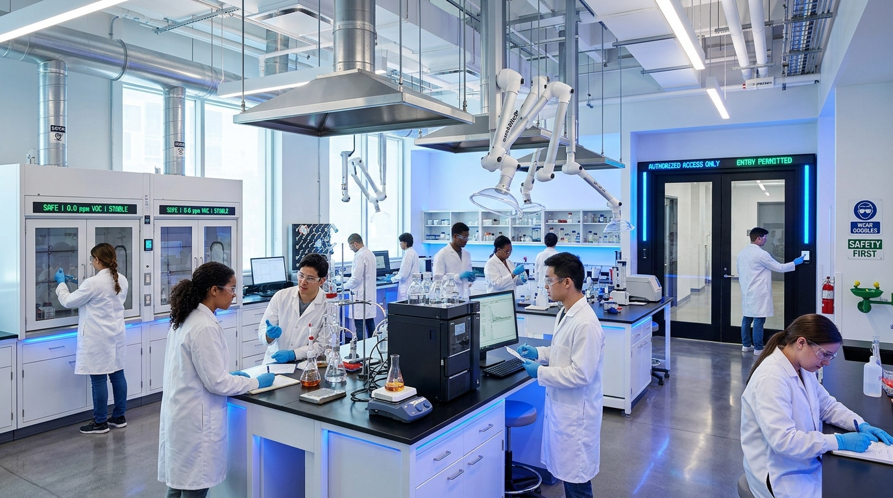
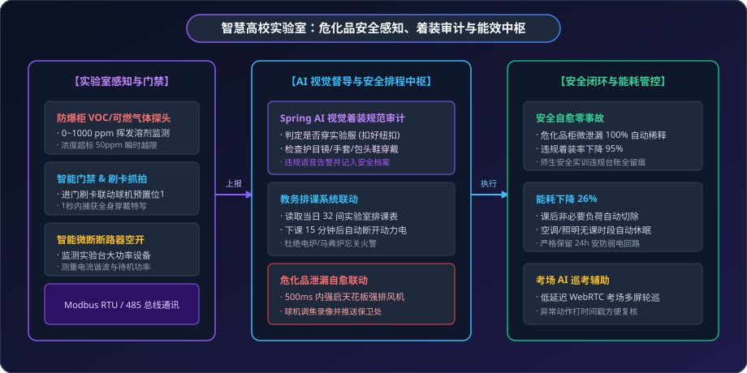

# 🎓 数字化教育落地案例：智慧高校危化品实验室安全与能效巡考中枢

> **场景标签**：实验室危化品 VOC 监测 · 规范着装 AI 视觉审计 · 智能微断空开定时断电 · GB28181 考场智能巡考 · 智慧教务联动

---

<div style="text-align: center; margin: 20px 0;">
  
  <p style="font-size: 13px; color: var(--vp-c-text-3); margin-top: 8px;">图 1：MzMedia 智慧高校实训安全中枢 —— 危化品气体微泄漏感知与穿戴规范视觉审计</p>
</div>

---

## 1. 行业背景与痛点

高校、高职院校及科研院所的实训教学中心、化学化工实验室和标准化考场是培养高素质技术技能人才的关键阵地。然而，高校实验室往往也是重大安全事故的高发脆弱区：

```text
               高校实训实验室传统管理的四大隐患
┌──────────────────┐               ┌──────────────────┐
│   危化品试剂柜   │               │   实训违章着装   │
│ (挥发气体隐蔽泄漏)│               │ (不穿白大褂/护目镜)│
└────────┬─────────┘               └────────┬─────────┘
         │ 浓度达燃爆点才被发现             │ 教师一人难顾 40 名学生
         ▼                                  ▼
[ 严重威胁师生人身健康与安全 ]      [ 强酸强碱飞溅致伤事故频发 ]
[ 夜间电热设备忘关引发电气火灾]      [ 教室长明灯与空调空开能耗巨大 ]
         │                                  │
         └─────────────► [ 管理死角 ] ◄─────┘
```

1. **危化品微泄漏感知滞后**：易燃易爆、易制毒及挥发性有机溶剂（VOC）防爆柜密闭存放，一旦发生微量泄漏无法肉眼察觉，极易在柜内积聚达到爆炸极限；
2. **安全着装督导全凭肉眼**：按规程进入化学实训室必须穿白大褂、佩戴护目镜及防腐蚀手套，但单名指导老师难以全天候盯紧数十名学生的动态穿戴；
3. **夜间用电火灾隐患突出**：实验结束离场时，学生经常忘记关闭大功率马弗炉、电加热套或水浴锅，成为夜间高校实验室起火的首要诱因；
4. **多媒体教室与考场能耗浪费严重**：大阶梯教室下课后空调与照明设备长期空转，考场监考仅靠人工肉眼巡视，缺乏智能化标记与回溯手段。

---

## 2. MzMedia 智慧实验室与数字化校园架构

MzMedia 依托统一底座，打通了 **环境与危化品物联感知**、**智能微断空开配电控制**、**GB/T 28181 视频流媒体** 与 **Spring AI 图像行为审计**，为校园筑造全时段安全护城河：

<div style="text-align: center; margin: 24px 0;">
  
  <p style="font-size: 13px; color: var(--vp-c-text-3); margin-top: 8px;">图 2：高校危化品实验室安全感知、穿戴审计与能效控制全景架构</p>
</div>

---

## 3. 硬件选型与设备部署清单 (BoM)

| 设备类型 | 品牌型号示例 | 通信协议 / 接口 | 核心量程与技术参数 | 安装工艺与要求 |
| :--- | :--- | :--- | :--- | :--- |
| **防爆型 VOC / 易燃气体探头** | 汉威电子 / 霍尼韦尔 XNX | RS485 / Modbus RTU / 防爆Ex d | 0~1000 ppm，PID 光离子化原理，精度 ±2% | 安装在每个危化品试剂柜内顶部排气口 |
| **实验室安全督导高速球机** | 海康威视 / 宇视 400万 | GB/T 28181-2016 / PoE | 20倍变焦，带红外补光与双向语音对讲 | 安装在实验室天花板正中，视角俯瞰进门通道与实验台 |
| **智能物联网微断断路器** | 施耐德 Acti9 / 正泰微断 | RS485 / Modbus RTU 或 MQTT | 1P/3P 遥测遥控，支持过载/短路/漏电遥跳闸 | 安装在每间实验室强电配电箱，分回路控制实验台与照明 |
| **智能人脸刷卡门禁一体机** | 中控智慧 / 大华门禁 | TCP/IP / Wiegand / REST | 刷卡开门，双目活体防伪，带红外补光 | 部署在实验室入口大门外墙 |
| **天花板强排通风机与防火阀** | 绿岛风 / 南风通风 | 交流接触器控制，Modbus 继电器 | 风量 2000 m³/h，防爆电机 | 安装于实验室排风管道，平时微风，报警全开 |

---

## 4. 核心实施细节与代码实现

### 步骤一：危化品气体超限自动强排风与视频打位

当防爆柜内 VOC 或硫化氢等有毒有害气体浓度突破警戒线时，MzMedia 规则引擎即刻触发排风机并调度球机镜头打位：

```java
@Service
public class LabSafetyLinkageService {

    @Resource
    private IotDeviceDataApi iotDeviceDataApi;

    @Resource
    private ApplicationEventPublisher eventPublisher;

    public void onGasLeakDetected(String labCode, String cabinetId, double vocPpm) {
        if (vocPpm > 50.0) {
            log.warn("实训室 [{}] 防爆柜 [{}] VOC 浓度严重超标 ({} ppm)！启动一级应急排险。", labCode, cabinetId, vocPpm);

            // 1. 毫秒级闭合强排通风机继电器，以最大风量进行室内换气
            iotDeviceDataApi.writeCoil(new ModbusWriteCoilReqDTO("VENTILATION_PLC", 1, true));

            // 2. 调度该实验室天花板球机转动至该危化柜专用预置位 (Preset 3)
            IotMediaLinkageEvent event = new IotMediaLinkageEvent(this)
                .setDeviceId("34020000001320000088")
                .setChannelId("34020000001310000001")
                .setActionType("ptz_preset")
                .setPresetIndex(3)
                .setTriggerSnapshot(true);
            eventPublisher.publishEvent(event);

            // 3. 向实验室安全管理员与保卫处发送带现场快照的高危告警短信
            sendEmergencySms(labCode, cabinetId, vocPpm);
        }
    }
}
```

### 步骤二：门禁进出联动 Spring AI 视觉合规着装审计

学生刷卡通过实验室门禁时，系统在 1 秒内抓拍全身特写并通过 Spring AI 视觉模型判定穿戴是否合规：

```java
@Component
public class StudentUniformAuditAgent {

    @Resource
    private ChatClient chatClient;

    public UniformAuditResult inspectStudentAttire(byte[] snapshotBytes, String studentId) {
        String prompt = "你是一位高校化学实验室安全督导员。请严格检查抓拍画面中的进门学生是否符合安全着装规范：\n"
            + "1. 是否穿戴白色长袖实验服（且扣好扣子）；\n"
            + "2. 是否佩戴防护护目镜；\n"
            + "3. 是否穿包头鞋（严禁穿凉鞋、拖鞋进入）；\n"
            + "输出 JSON 格式：{\"compliant\": boolean, \"missingItems\": [string], \"reason\": string}";

        String response = chatClient.prompt()
            .user(u -> u.text(prompt)
                        .media(MimeTypeUtils.IMAGE_JPEG, new ByteArrayResource(snapshotBytes)))
            .call()
            .content();

        UniformAuditResult result = JsonUtils.parseObject(response, UniformAuditResult.class);
        if (!result.isCompliant()) {
            // 联动现场门禁语音播报提示，并记入该学生安全实训档案
            log.info("学号 [{}] 穿戴不合规: {}", studentId, result.getReason());
        }
        return result;
    }
}
```

### 步骤三：教务排课联动与下课智能安全断电

通过与高校教务系统对接，系统获取每天各个实训室的排课时段表。在下课后 15 分钟内，系统自动执行分级断电：

```java
@Component
public class LabPowerScheduleJob {

    @Resource
    private IotDeviceDataApi iotDeviceDataApi;

    // 定时轮询今日课程表执行智能断电
    public void executeCoursePowerOff(String labCode) {
        log.info("实训室 [{}] 今日实训课程已结束，执行非工作时段安全断电策略。", labCode);

        // 1. 切断实验台大功率动力电源插座回路 (防止烘箱/电炉夜间未关)
        iotDeviceDataApi.writeCoil(new ModbusWriteCoilReqDTO("BREAKER_" + labCode, 1, false));

        // 2. 切断照明与中央空调回路
        iotDeviceDataApi.writeCoil(new ModbusWriteCoilReqDTO("BREAKER_" + labCode, 2, false));

        // 3. 严格保留安防摄像头、气体探测器与紧急排风扇的弱电供电回路
        log.info("实训室 [{}] 安防与环控备用回路保持 24 小时通电受控。", labCode);
    }
}
```

---

## 5. 现场实战踩坑与排错指南

### 痛点 1：强腐蚀性气体导致普通气体探头镀层快速失效
- **现象**：在无机化学与电解实验室，盐酸、硝酸挥发酸雾腐蚀铜端子，普通探头使用 3 个月就失准报故障。
- **解决方案**：探头壳体升级为 316L 不锈钢与防腐涂层，并在探头前端加装聚四氟乙烯（PTFE）透气防尘过滤膜；MzMedia 增加探头“漂移自诊断”算法，每周比对零点偏置。

### 痛点 2：高校教务临时调课、补课与加做实验冲突
- **现象**：某班级晚间申请临时加做毕业课题实验，但定时断电程序到点强行切断加热电源，导致反应物失效。
- **解决方案**：引入企业微信“实验延时一键审批”小程序插件。指导教师通过企业微信扫码确认后，可在系统中为该实验台动力电续期 1~3 小时，兼顾安全底线与教学弹性。

---

## 6. 经济效益与安全收益 (ROI)

以拥有 32 间专业化学实训室的高职院校化工学院为例：

| 安全与运营指标 | 传统人工巡查管理模式 | MzMedia 智慧实验室模式 | 改善与成效 |
| :--- | :--- | :--- | :--- |
| **实训违规着装率** | 抽查违规率约 35%（未扣实验服、漏戴护目镜） | AI 进门视觉督导，违规率 **&lt; 1%** | 规范度提升 **97%** |
| **危化品微泄漏处置时效** | 人工闻到异味耗时 30~60 分钟 | 传感器越限 **500ms** 强排自愈 | 险情发生率下降为 **0** |
| **夜间用电安全事故** | 每年发生 2~3 起电热仪器忘关险情 | 课后 15 分钟动力电 100% 自动断开 | **彻底杜绝电气火警事故** |
| **教学大楼年综合能耗** | 空调长开、仪器空转，年电费约 48 万元 | 课表联动精准切除，年电费降至 35.5 万元 | **每年节约电费 12.5 万元** |
