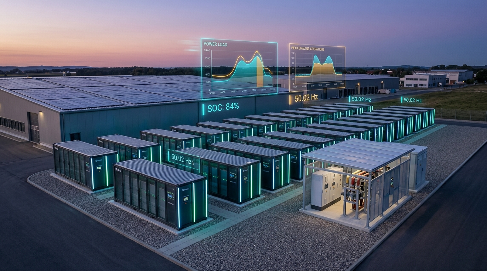
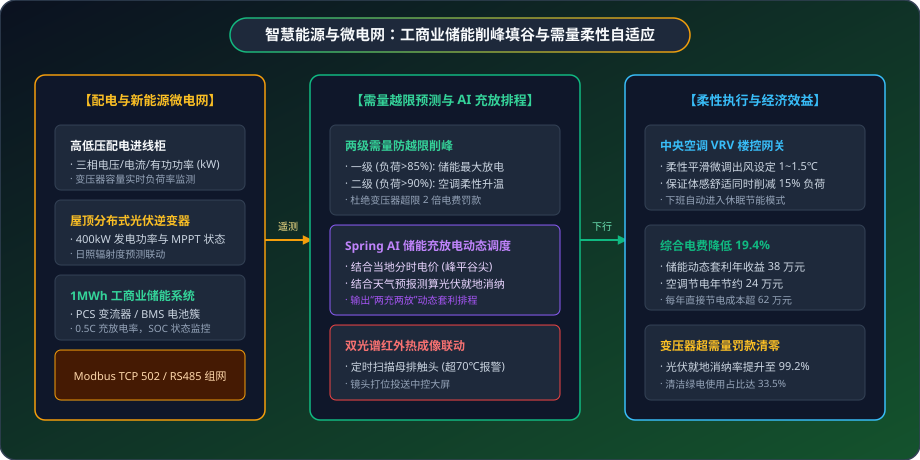

# ⚡ 智慧能源与低碳建筑落地案例：工商业储能、空调节能与微电网智能调度

> **场景标签**：Modbus TCP/RTU 电力仪表 · 工商业储能峰谷套利 · 变压器最大需量控制 · 多联机中央空调柔性自适应 · 双光谱热成像测温

---

<div style="text-align: center; margin: 20px 0;">
  
  <p style="font-size: 13px; color: var(--vp-c-text-3); margin-top: 8px;">图 1：MzMedia 智慧微电网能源调度中心 —— 屋顶光伏、工商业储能与负荷数字孪生</p>
</div>

---

## 1. 行业背景与痛点

在大型工商业产业园区、高耗能制造工厂和现代低碳写字楼中，电力成本通常占据企业日常运营成本的 20%~30%。随着国家深化“两部制电价”改革与分时电价峰谷价差的拉大，企业在用电管理上普遍面临三大难题：

```text
                  传统工商业用电的三大成本黑洞
┌──────────────────┐               ┌──────────────────┐
│   变压器超需量   │               │   空调粗放运行   │
│ (尖峰负荷触发惩罚)│               │ (下班忘关/过度制冷)│
└────────┬─────────┘               └────────┬─────────┘
         │ 超过合同最大需量产生巨额罚金      │ 夏季设定 18℃ 导致能耗飙升
         ▼                                  ▼
[ 每月数万元额外超需量电费支出 ]     [ 电力浪费高达总能耗 30% ]
[ 储能设备策略呆板未能最大化套利 ]   [ 配电母排过热缺乏视频热成像直观监控 ]
         │                                  │
         └─────────────► [ 利润被严重侵蚀 ] ─┘
```

1. **变压器尖峰越限导致巨额罚款**：夏季或冬季生产高峰期，多联机中央空调与生产设备同时启动，极易超出变压器报装的最大需量，按两部制电价规定，超限部分需按 2 倍支付基本电费，每月罚款动辄上万元；
2. **储能电站策略僵化，光伏消纳率低**：自建分布式屋顶光伏和储能系统后，许多企业仅按固定时钟执行固定的“早充晚放”，未能结合实时天气预测、日前电价动态以及车间生产负荷曲线进行动态柔性优化，造成部分时段“弃光”；
3. **配电柜隐患缺乏直观预警**：高压柜母排接头、变压器绕组因老化氧化在大电流下发热，传统人工每月红外巡检一次，难以及时捕捉突发温升，存在重大电气火灾隐患。

---

## 2. MzMedia 智慧能源协同微电网架构

MzMedia 将 **高低压配电柜多功能仪表接入**、**储能 PCS/BMS 通信协议**、**中央空调楼宇控制**、**GB/T 28181 红外热成像双光谱摄像机** 与 **Spring AI 负荷预测优化引擎** 全面贯通：

<div style="text-align: center; margin: 24px 0;">
  
  <p style="font-size: 13px; color: var(--vp-c-text-3); margin-top: 8px;">图 2：微电网多能互补、最大需量柔性防越限与储能智能充放排程架构</p>
</div>

---

## 3. 硬件选型与设备部署清单 (BoM)

| 设备类型 | 品牌型号示例 | 协议 / 接口 | 核心量程与技术参数 | 安装部署工艺与要求 |
| :--- | :--- | :--- | :--- | :--- |
| **高精度电力多功能仪表** | 安科瑞 APM800 / 施耐德 PM8000 | Modbus TCP 端口 502 / 以太网 | 0.2S 级精度，计量电压、电流、有功/无功功率、2~63次谐波 | 安装在配电室各进线柜、电容补偿柜面板 |
| **工商业储能 PCS 变流器** | 汇川 / 阳光电源 250kW | RS485 / Modbus RTU / CAN | 额定输出 250kW，转换效率 &gt; 98.5%，充放电切换 &lt; 20ms | 户外储能集装箱内，与 BMS 电池簇一体化集成 |
| **屋顶光伏组串逆变器** | 华为 SUN2000 / 锦浪 110K | RS485 转 4G DTU / Modbus RTU | 最大效率 98.8%，多路 MPPT 独立追踪 | 安装在厂房屋顶阴凉处，就近接入光伏支架 |
| **中央空调 VRV 楼控网关** | 大金 / 远大 / 海尔楼宇网关 | Modbus RTU / BACnet IP | 支持对 64 台室内机设定温度、风速、启闭模式 | 安装在弱电配电间，RS485 总线手拉手连接室内机 |
| **红外双光谱热成像球机** | 海康威视 / 大华热成像双目 | GB/T 28181-2016 / PoE | 热成像分辨率 384×288，测温范围 -20~550℃ (精度 ±2℃) | 吊装于配电房主走道天花板，定时对各母排接头巡检 |

---

## 4. 核心实施细节与代码实现

### 步骤一：变压器最大需量越限预测与柔性削峰控制

在 `yudao-module-iot` 规则引擎中配置变压器需量保护逻辑，当负荷达到额定容量 85% 时自动启动储能顶峰；若超过 90% 则平滑调高空调设定温度：

```java
@Service
public class DemandPeakShavingEngine {

    @Resource
    private IotDeviceDataApi iotDeviceDataApi;

    private static final double TRANSFORMER_RATED_KW = 1250.0; // 变压器额定容量 1250 kVA

    public void evaluateLoad(double currentTotalKw) {
        double loadRatio = currentTotalKw / TRANSFORMER_RATED_KW;

        if (loadRatio > 0.85 && loadRatio <= 0.90) {
            log.info("当前负荷率已达 {:.1f}%，触发一级削峰：指令工商业储能 PCS 最大功率放电！", loadRatio * 100);
            
            // 下发 Modbus 寄存器：指令储能变流器 (PCS) 切换至放电模式，输出 250 kW
            iotDeviceDataApi.writeHoldingRegister(new ModbusWriteRegisterReqDTO("STORAGE_PCS_01", 200, 250));
        } else if (loadRatio > 0.90) {
            log.warn("当前负荷率已达 {:.1f}%，逼近最大需量红线！触发二级削峰：空调柔性升温 1.5℃。", loadRatio * 100);
            
            // 联动楼宇中央空调 Modbus 网关，将当前设定温度调高 1.5℃，降低压缩机做功
            iotDeviceDataApi.writeHoldingRegister(new ModbusWriteRegisterReqDTO("HVAC_GATEWAY", 305, 260)); // 设定 26.0℃
        }
    }
}
```

### 步骤二：Spring AI 驱动的储能充放电动态策略

结合当地电网峰平谷分时电价（如夜间谷电 0.32 元/kWh，白天尖峰 1.48 元/kWh），Spring AI 智能体根据天气预测与历史用电负荷生成充放电时间表：

```java
@Component
public class EnergyOptimizationAgent {

    @Resource
    private ChatClient chatClient;

    public StorageSchedulePlan generateOptimalSchedule(String weatherSummary, double currentSoc) {
        String prompt = "你是工业微电网高级能源调度专家。请根据以下参数输出储能系统（容量 1000kWh，最大充放电倍率 0.5C）的今日充放电排程：\n"
            + "1. 当地电价：谷段 [00:00-08:00] (0.32元), 平段 [08:00-11:00, 13:00-17:00] (0.75元), 峰段 [17:00-19:00] (1.18元), 尖峰段 [11:00-13:00, 19:00-21:00] (1.48元)；\n"
            + "2. 日前天气：" + weatherSummary + "（影响屋顶 400kW 光伏出力）；\n"
            + "3. 储能当前剩余电量 (SOC)：" + currentSoc + "；\n"
            + "请以 JSON 格式输出今日充放电时段清单，并计算预估峰谷套利收益。";

        String jsonPlan = chatClient.prompt()
            .user(prompt)
            .call()
            .content();

        return JsonUtils.parseObject(jsonPlan, StorageSchedulePlan.class);
    }
}
```

### 步骤三：配电柜接头热成像与红外双光谱球机测温联动

在配电房部署 GB/T 28181 红外热成像球机，对关键进线柜与补偿柜母排接头定时巡检：

```java
@EventListener
public void onThermalAnomaly(ThermalAlarmEvent event) {
    if (event.getSpotTemp() > 70.0) {
        log.error("配电母排接点 [{}] 表面温度异常升高至 {} ℃！立即执行视频锁定。", event.getSpotName(), event.getSpotTemp());

        // 1. 驱动双光谱球机调至发热点预置位
        IotMediaLinkageEvent mediaEvent = new IotMediaLinkageEvent(this)
            .setDeviceId(event.getCameraDeviceId())
            .setChannelId(event.getChannelId())
            .setActionType("ptz_preset")
            .setPresetIndex(event.getPresetIndex())
            .setTriggerSnapshot(true);
        applicationEventPublisher.publishEvent(mediaEvent);

        // 2. 将红外假彩色温分布视频流自动推送到动力值班中控室大屏
        pushThermalStreamToDashboard(event.getCameraDeviceId(), event.getChannelId());
    }
}
```

---

## 5. 现场实战踩坑与排错指南

### 痛点 1：锂电池储能系统 SOC（荷电状态）的虚电与漂移
- **现象**：储能电池在多次未充满、未放尽的情况下，BMS 库仑计积分累积误差导致 SOC 虚高，放电提前跳闸。
- **解决方案**：MzMedia 接入电池簇单体电压（Cell Voltage）监控，配置“每周浅充浅放完全校准任务”，利用静置开路电压（OCV）曲线强制校正 SOC 基准，保障充放电深度利用率达 95% 以上。

### 痛点 2：中央空调升温过快导致车间工人投诉体感闷热
- **现象**：当变压器负荷瞬间逼近 90% 时，若将车间空调设定温度一次性从 24℃ 调高至 27℃，送风骤停引起闷热感。
- **解决方案**：引入**“梯度柔性微调步长”**。每次仅微调 0.5℃，间隔 8 分钟评估一次变压器负荷，既通过压缩机减频削减了 15% 尖峰功率，又保证人体几乎感知不到温差突变。

---

## 6. 经济效益与投资回报率 (ROI)

以某年用电量 320 万度的精密制造园区（配有 1250kVA 变压器、400kW 光伏与 1MWh 储能）为例：

| 费用构成项 | 传统用电粗放管理 | MzMedia 智能调度与微电网 | 优化改善幅度 |
| :--- | :--- | :--- | :--- |
| **分时电费峰谷套利收益** | 机械固定时间充放，套利 21 万元/年 | AI 动态预测日排程，套利 38 万元/年 | **多赚取收益 17 万元/年** |
| **空调节电效益** | 夏季设定 20℃，空调节电收益为 0 | 柔性自适应控温，年节约电量 28 万度 | **直接省电费 24 万元/年** |
| **变压器超需量违约罚款** | 每年发生 4~6 次超额罚款，支出 12 万元 | 两级削峰保护，超需量发生率为 0 | **节约罚款支出 12 万元/年** |
| **光伏就地消纳率** | 弃光率约 15% (损失 9 万元/年) | 提升至 99.2%，实现全额就地自发自用 | **增收 8.5 万元/年** |
| **综合年化净节约** | - | 每年综合节省与增收超 **61.5 万元** | 智能化改造投入 32 万元，**6.2 个月回本** |
