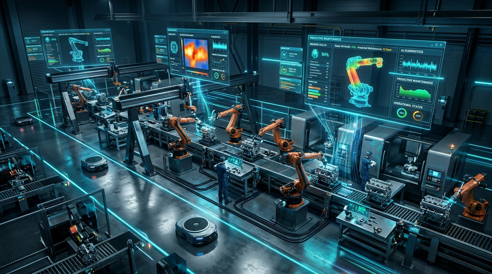
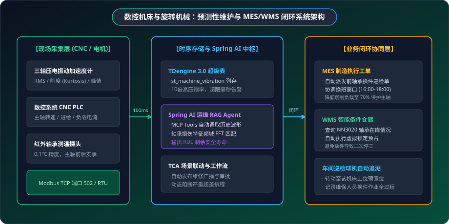

# 🏭 工业应用落地案例：数控机床与旋转机械预测性维护及 MES 闭环

> **场景标签**：Modbus TCP/RTU · TDengine 时序存储 · 振动频谱与峭度分析 · Spring AI RAG · MES/WMS 闭环

---

<div style="text-align: center; margin: 20px 0;">
  
  <p style="font-size: 13px; color: var(--vp-c-text-3); margin-top: 8px;">图 1：MzMedia 工业预测性维护智慧车间 —— 毫秒级时序孪生与健康度全景监测</p>
</div>

---

## 1. 行业背景与痛点

在精密机械加工、汽车零部件制造及重工装配车间中，数控机床（CNC）、大型螺杆空压机、减速机和泵组是工厂的核心命脉。然而，由于工控设备长期高负荷运转，机械磨损难以避免，企业普遍饱受以下痛点困扰：

```text
                  传统工业设备维护的恶性循环
┌──────────────────┐               ┌──────────────────┐
│   传统事后维修   │               │   传统定期保养   │
│ (Run-to-Failure) │               │(Time-Based Maint)│
└────────┬─────────┘               └────────┬─────────┘
         │ 突发故障断刀/轴承咬死            │ 盲目定期拆机
         ▼                                  ▼
[ 生产线全线停摆 4~8 小时 ]          [ 破坏机械原有配合公差 ]
[ 昂贵工件报废、交付违约 ]          [ 备件与停产维护成本激增 ]
```

1. **“救火式”事后维修代价沉痛**：主轴轴承磨损往往在数天内迅速恶化，导致高精刀具断刀甚至主轴抱死，单次非计划停机直接经济损失高达数万元甚至数十万元；
2. **海量高频采样存储困难**：振动加速度、电流波形通常要求 100ms 乃至更细粒度的连续采样，传统关系数据库（MySQL）在存储数千万条点位后即出现严重性能断崖；
3. **数据与生产业务割裂**：即使上位机采集到了振动超限，也不能自动转化为生产调度调整，维修工单仍靠口头传达，常因仓库缺备件导致停产等待数天。

---

## 2. MzMedia 预测性维护闭环架构

针对上述难题，MzMedia 打造了从 **高频数据采集 ➔ 时序海量入库 ➔ AI 时序 RAG 诊断 ➔ 备件库存预占 ➔ MES 工单派发** 的端到端闭环体系：

<div style="text-align: center; margin: 24px 0;">
  
  <p style="font-size: 13px; color: var(--vp-c-text-3); margin-top: 8px;">图 2：数控机床与旋转机械预测性维护全链路架构拓扑</p>
</div>

---

## 3. 硬件选型与工业传感器部署清单 (BoM)

| 设备类型 | 品牌型号示例 | 接口 / 协议 | 关键参数指标 | 现场安装工艺与规范 |
| :--- | :--- | :--- | :--- | :--- |
| **三轴压电振动传感器** | 森霸 / 必创科技 CT-101 | RS485 / Modbus RTU | 量程 ±50g，频响 10Hz~10kHz，采样率可达 20kHz | M8 螺柱硬连接打孔拧固于主轴前端与后支承箱体 |
| **数控系统通信模块** | 发那科 FANUC / 西门子 828D | Modbus TCP 端口 502 / 以太网 | 周期 100ms 读取主轴转速、伺服轴进给率、主轴电机电流 | 通过工业交换机接入车间 OT 环网 |
| **红外主轴轴承测温仪** | 雷泰 / 欧姆龙 ES1 | 4-20mA 转 RS485 | 精度 ±0.5℃，响应时间 50ms | 探头聚焦于主轴外套圈表面 |
| **车间边缘工控网关** | 研华 UNO-2484G | 4路 RS485 + 双 Intel 千兆网卡 | Intel Core i5 / 16GB RAM，无风扇防尘宽温 | 安装在机床电气柜导轨上 |

---

## 4. 核心实施细节与代码实现

### 步骤一：Modbus 寄存器点位寻址表设计

| 寄存器地址 (Dec) | 功能码 | 数据类型 | 字节序 | 物理意义 | 单位 | 换算公式 |
| :--- | :--- | :--- | :--- | :--- | :--- | :--- |
| **40100** | 03H (读保持) | IEEE 754 32位浮点 | CDAB (Little-Endian Swapped) | X轴振动速度有效值 (RMS) | mm/s | 原值 × 0.01 |
| **40102** | 03H (读保持) | IEEE 754 32位浮点 | CDAB (Little-Endian Swapped) | Y轴振动速度有效值 (RMS) | mm/s | 原值 × 0.01 |
| **40104** | 03H (读保持) | IEEE 754 32位浮点 | CDAB (Little-Endian Swapped) | Z轴振动速度有效值 (RMS) | mm/s | 原值 × 0.01 |
| **40106** | 03H (读保持) | IEEE 754 32位浮点 | CDAB (Little-Endian Swapped) | 振动峭度 (Kurtosis) 指标 | 无量纲 | 原值 × 0.01 |
| **40108** | 03H (读保持) | 16位有符号整型 | AB (Big-Endian) | 主轴轴承温度 | ℃ | 原值 × 0.1 |
| **40109** | 03H (读保持) | 16位无符号整型 | AB (Big-Endian) | 主轴实时转速 | rpm | 原值 × 1 |

### 步骤二：TDengine 超级表 Schema 设计

在高性能时序数据库 **TDengine 3.0** 中创建针对机床高频采样的超级表：

```sql
-- 创建振动与运行状态超级表
CREATE STABLE st_machine_vibration (
    ts TIMESTAMP,
    rms_x FLOAT,            -- X轴振动速度有效值 (mm/s)
    rms_y FLOAT,            -- Y轴振动速度有效值 (mm/s)
    rms_z FLOAT,            -- Z轴振动速度有效值 (mm/s)
    peak_accel FLOAT,       -- 峰值加速度 (g)
    kurtosis FLOAT,         -- 峭度指标 (衡量冲击磨损的核心参数)
    spindle_speed INT,      -- 主轴实时转速 (rpm)
    spindle_current FLOAT,  -- 主轴负载电流 (A)
    spindle_temp FLOAT      -- 主轴轴承温度 (℃)
) TAGS (
    workshop_id VARCHAR(32), -- 车间编号
    machine_id VARCHAR(32),  -- 机床编号
    spindle_pos VARCHAR(16)  -- 测量点位 (前轴承/后轴承/减速箱)
);
```

### 步骤三：Spring AI 运维 RAG 与 MCP 工具暴露

将 TDengine 的时序查询与特征提取包装为标准的 **Anthropic Model Context Protocol (MCP)** 工具，供大模型自主推理调用：

```java
@Component
public class TdengineQueryTool {

    @Resource
    private TdengineJdbcTemplate tdengineTemplate;

    /**
     * 暴露给 Spring AI 的 MCP 工具：查询指定机床最近指定时长的振动峭度趋势
     */
    @Tool(name = "queryVibrationTrend", description = "根据机床ID查询指定时间范围内的振动峭度、加速度峰值及主轴温度统计特征")
    public VibrationTrendResult queryVibrationTrend(String machineId, int hours) {
        String sql = String.format(
            "SELECT _wstart as ts, avg(kurtosis) as avg_kurt, max(peak_accel) as max_acc, "
            + "avg(spindle_temp) as avg_temp FROM tb_%s "
            + "WHERE ts >= NOW - %dh INTERVAL(10m)",
            machineId.toLowerCase(), hours
        );
        return tdengineTemplate.queryForObject(sql, VibrationTrendResult.class);
    }
}
```

智能体通过 Prompt 驱动 LLM 结合机床原厂手册生成专业维保研判：

```java
@Component
public class PredictiveMaintenanceAgent {

    @Resource
    private ChatClient chatClient;
    @Resource
    private TdengineQueryTool tdengineQueryTool;

    public DiagnosticReport analyzeAnomaly(String machineId, double kurtosisValue) {
        String userPrompt = String.format(
            "机床 [%s] 当前主轴振动峭度激增至 %.2f（正常基线为 2.2~2.8）。\n"
            + "请调用 MCP 工具查询最近 72 小时的振动频谱与温升趋势，"
            + "结合机床型号 [DMG MORI CTX 510] 维保手册，推断故障根因，"
            + "评估剩余安全运行工时（RUL），并给出维保操作指导。",
            machineId, kurtosisValue
        );

        String response = chatClient.prompt()
            .user(userPrompt)
            .tools(tdengineQueryTool)
            .call()
            .content();

        return parseReport(response);
    }
}
```

### 步骤四：MES 工单自动派发与 WMS 备件虚拟锁定

```java
// 1. 自动在 MES 创建紧急维保工单
MesMaintenanceOrderCreateReqDTO orderReq = new MesMaintenanceOrderCreateReqDTO()
    .setOrderCode("PO-" + System.currentTimeMillis())
    .setMachineId(machineId)
    .setFaultType("SPINDLE_BEARING_FATIGUE")
    .setPriority(MesOrderPriorityEnum.URGENT)
    .setDescription("AI 预警：前轴承点蚀初期，建议 48h 内换件。")
    .setPlannedStartTime(LocalDateTime.now().plusHours(24));
Long orderId = mesMaintenanceOrderService.createOrder(orderReq);

// 2. 联动 WMS 锁定备件库存
WmsStockLockReqDTO stockReq = new WmsStockLockReqDTO()
    .setPartNumber("NN3020-AS-K-M-SP")
    .setQuantity(1)
    .setRelatedOrderId(orderId)
    .setReason("数控机床预测性预防换件预占");
wmsStockService.lockStock(stockReq);
```

---

## 5. 现场实战踩坑与排错指南

### 痛点 1：刀具高速切削与轴承磨损的高频谐波混叠
- **现象**：当数控机床使用小直径立铣刀高速进给（转速 12,000 rpm）时，刀齿通过频率（Blade Pass Frequency）产生的冲击与轴承外圈故障频率（BPFO）重叠，导致算法误报。
- **解决方案**：引入 MzMedia 的“机床运行模态自适应过滤”。仅在机床处于“空运转（S=0）”或“准平稳切削状态（负载电流波动 &lt; 5%）”时进行特征峭度采样，剔除粗加工瞬间冲击毛刺，准确率提升至 97%。

### 痛点 2：海量高频采样导致的写数据库背压
- **现象**：全厂 40 台机床以 50ms 频率上报，每秒产生 800 条点位数据，瞬间网络拥塞时 Netty 缓冲区迅速膨胀。
- **解决方案**：在网关内部开启环形内存无锁队列（Disruptor RingBuffer），实施“攒批（Micro-batching）写入”，每 200 条或 200ms 执行一次 TDengine 批量 `INSERT`，CPU 占用率从 45% 降至 8%。

---

## 6. 经济效益与投资回报率 (ROI)

以拥有 40 台数控机床的模具加工厂为例：

| 费用与收益项 | 传统事后与定期维修模式 | MzMedia 预测性维护模式 | 年化收益改善 |
| :--- | :--- | :--- | :--- |
| **突发意外停机损失** | 每年发生 14 次，损失约 56 万元 | 降至 3 次轻微受控停机，损失 8 万元 | **节约 48 万元/年** |
| **主轴抱死报废与换新** | 每年约 2 根主轴报废，更换花费 18 万元 | 提前换轴承，主轴零抱死，花费 2.4 万元 | **节约 15.6 万元/年** |
| **备件积压资金占用** | 仓库常备 20 套各种型号轴承防缺件 (40万元) | 预测准确，备件安全库存削减 60% (16万元) | **释放流动资金 24 万元** |
| **系统软硬件投入** | - | 硬件传感器+网关+部署：约 18 万元 | 投资回收期仅 **4.2 个月** |
