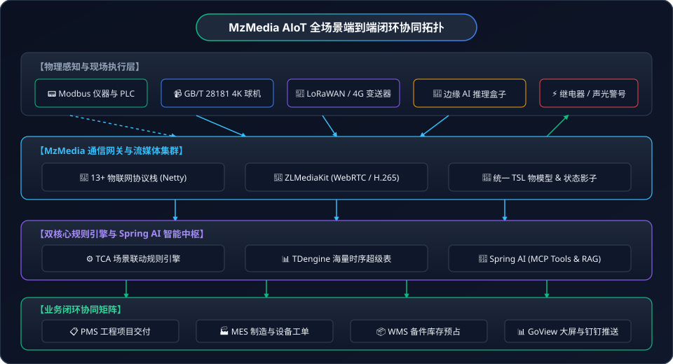

# 💼 AIoT 行业落地案例全景

从设备孤岛到“声光电像智”全面协同，看 MzMedia 如何赋能千行百业实现低成本、高可靠的数字化转型与智能化运维。

---

## 🏗️ 方案全景架构拓扑

MzMedia 将 **13+ 种工业物联网协议网关**、**GB/T 28181 安防流媒体中枢** 与 **Spring AI 智能中枢** 紧密缝合，构建了覆盖物理感知、边缘流媒体、核心规则引擎与企业业务协同的全栈闭环体系：

<div style="text-align: center; margin: 24px 0;">
  
  <p style="font-size: 13px; color: var(--vp-c-text-3); margin-top: 8px;">图 1：MzMedia 企业级 AIoT 全场景物理感知、边缘流媒体、规则时序与业务闭环协同总拓扑</p>
</div>

---

## 🌐 行业解决方案矩阵对照

传统的物联网方案往往“只看数据不看实况”，安防视频系统“事后查证无法主动预警”，业务系统（MES/PMS/WMS）与底层工控硬件更是互为烟囱。MzMedia 在以下行业深水区形成了标准化的落地落盘模板：

| 行业场景 | 客户典型痛点 | MzMedia 破局方案 | 核心协同技术 | 标杆客户实测 ROI |
| :--- | :--- | :--- | :--- | :--- |
| [**📹 视频深度联动**](/cases/video-linkage) | 传感器告警无画面，安保翻查录像耗时 15 分钟，错过黄金处置时机 | 传感器超限 1.8 秒内驱动球机预置位旋转（0x81），自动切片录像与 AI 视觉复核 | TCA 规则引擎 + GB28181 SIP + WebRTC 低延时直播 + 多模态视觉大模型 | 故障实况响应时间从 **15 分钟降至 1.8 秒**，误报复核人工减少 85% |
| [**🏭 工业预测性维护**](/cases/industrial) | 机床与旋转机械非计划突发停机，损失高昂；人工巡检难以及时发现早期隐患 | Modbus 高频采集振动/温升/电流，TDengine 列式高压缩时序存储，Spring AI RAG 诊断基线偏离 | Modbus TCP + TDengine 3.0 + Spring AI MCP + MES 闭环工单 + WMS 备件预占 | 突发意外停机减少 **62%**，MTTR 从 6.5h 降至 1.8h，单产线年挽损 40+ 万元 |
| [**🛡️ 智慧园区智能安防**](/cases/security) | 周界防范误报频发（风吹草动小动物），安保疲于奔命；夜间盲区多、取证难 | 脉冲电子围栏触碰瞬间联动 4K 球机预置位追踪，边缘视觉检测过滤干扰，反向声光震慑驱离 | 脉冲围栏 + GB28181 PTZ + YOLO 边缘视觉 + Modbus 爆闪警号反控 | 夜间误报率降至 **1.5%** 以下，真实入侵拦截率 100%，安保人力成本缩减 40% |
| [**🌱 现代设施农业**](/cases/agriculture) | 靠天吃饭、凭经验浇水施肥；温湿度剧变导致作物病害爆发，优质果品率低 | 温室温湿度、土壤水肥四合一多参数物联采集，自适应闭环驱动天窗/风机，AI 巡航识别早期病斑 | LoRaWAN / Modbus + 农业 TSL + 自适应水肥环控 + 云台多预置位视觉巡检 | 节水 32%、节肥 25%，早期病虫害发现提前 3~5 天，一人可轻松统筹 20 栋大棚 |
| [**🎓 数字化教育与实验室**](/cases/education) | 高校危化品防爆柜泄漏隐患大；实训违章着装难监管；大功率仪器忘关引发火警 | 防爆柜 VOC 与温湿度 7×24h 盯防，门禁联动球机 AI 识别实验服/护目镜，课表联动安全断电 | VOC 传感器 + GB28181 预置位抓拍 + AI 视觉合规审计 + 智能微断空开 | 违规操作率下降 **95%**，危化品泄漏隐患秒级自愈排风，教学用电能耗削减 26% |
| [**⚡ 智慧能源与低碳建筑**](/cases/energy-carbon) | 需量超标罚款高，中央空调能耗过大，光伏消纳不足，峰谷套利缺乏动态策略 | 毫秒级采集电力仪表与储能状态，根据分时电价智能调度充放电，空调温度动态柔性调优 | Modbus RTU/TCP + BMS/PCS 变流器 + 需量越限预测 + 柔性负荷控制 | 综合用电成本降低 **19.4%**，光伏消纳率提升至 99.2%，杜绝超需量违约金 |

---

## 🛠️ 标准化工程落地实施 4 步法

基于 MzMedia 的众多客户落地经验，我们总结了快速、低风险上线 AIoT 系统的标准化四步法：

```text
 ┌───────────────────────┐      ┌───────────────────────┐
 │ 阶段一：现场勘测与拓扑规划 │ ───► │ 阶段二：协议接入与物模型建模 │
 │ · 点位布设与硬件 BoM 清单 │      │ · Modbus 寄存器与字节序校验 │
 │ · 网络 VLAN 与带宽时延测算 │      │ · GB28181 国标通道与预置位录入│
 └───────────────────────┘      └───────────────────────┘
                                                │
                                                ▼
 ┌───────────────────────┐      ┌───────────────────────┐
 │ 阶段四：运营自愈与闭环进化 │ ◄─── │ 阶段三：TCA 规则与 AI 联调   │
 │ · MES 工单全流程流转跟踪   │      │ · 越限阈值与动作链配置       │
 │ · 时序 RAG 维保知识库更新  │      │ · Spring AI 提示词与视觉微调 │
 └───────────────────────┘      └───────────────────────┘
```

1. **阶段一：现场勘测与拓扑规划**
   - 梳理现场传感器、仪表、PLC、网络摄像机的物理布线走向；
   - 划分网络网段（工控网 VLAN 与安防监控网 VLAN），根据视频路数规划核心交换机背板带宽（每路 4K H.265 按 4~6 Mbps 预留）。
2. **阶段二：协议接入与物模型统一建模**
   - 登录 MzMedia 控制台，基于产品模版建立统一物模型（TSL）；
   - 使用在线工具校验 Modbus 点位大端/小端字节序（ABCD / CDAB），配置 GB28181 SIP 接入鉴权密码并完成摄像机通道自动目录发现。
3. **阶段三：TCA 规则与 Spring AI 智能体联调**
   - 配置 Trigger（属性上报/状态跳变）与 Condition（多条件与生效时段）；
   - 绑定 Action（下发预置位 0x81、开始云端录像、触发反控继电器）；
   - 挂载 Spring AI 多模态视觉复核模型或时序 RAG 工具链，过滤物理误报。
4. **阶段四：业务协同闭环与持续进化**
   - 打通协同矩阵：对接企业微信/钉钉 Webhook 告警机器人，打通 MES 维保派工单与 WMS 备件虚拟锁定；
   - 持续将设备原厂维保手册注入 Spring AI 知识库，使系统自愈与排障决策日益精准。

---

## 💻 生产环境软硬件选型与部署规格建议

| 接入规模 | 传感器点位 | 视频接入路数 | 推荐服务器硬件规格 | 架构拓扑部署形式 |
| :--- | :--- | :--- | :--- | :--- |
| **基础体验级** | &lt; 200 点 | 1 ~ 8 路 | 4 核 CPU / 8GB 内存 / 500GB SSD | 单机 Docker Compose 容器化快速启动 |
| **标准工业级** | 200 ~ 2,000 点 | 8 ~ 32 路 | 8 核 CPU / 16GB 内存 / 2TB NVMe SSD | 单物理机运行 MzMedia 底座 + TDengine + ZLMediaKit |
| **企业高可用级** | 2,000 ~ 20,000 点 | 32 ~ 128 路 | 2台 16核 / 32GB 内存集群 + 10Gbps 网卡 | MzMedia 双机热备 + EMQX 分布式集群 + ZLMediaKit 负载均衡 + MinIO 集中存储 |
| **大型园区综合体**| &gt; 20,000 点 | &gt; 128 路 | K8s 容器编排集群 + 独立流媒体节点群 | 分布式微服务架构 + TDengine 时序高可用多副本 + 边缘计算盒子卸载 AI 推理 |

---

## 💡 选择场景深入了解

点击下方卡片，查看详尽的场景痛点、硬件选型清单、物模型定义、规则引擎配置及实战核心源码：

<div style="display: grid; grid-template-columns: repeat(auto-fit, minmax(280px, 1fr)); gap: 16px; margin-top: 24px;">

<div style="border: 1px solid var(--vp-c-border); border-radius: 8px; padding: 18px; background: var(--vp-c-bg-soft);">
  <h3>📹 <a href="/cases/video-linkage">视频与传感器联动</a></h3>
  <p style="font-size: 13px; color: var(--vp-c-text-2); margin-top: 8px;">
    消灭“只报警告警看不到现场”的盲人摸象痛点。传感器超限 1.8 秒内驱动球机预置位旋转、自动录像切片与大屏置顶。
  </p>
  <div style="margin-top: 12px; font-size: 12px; font-weight: bold; color: var(--vp-c-brand-1);">
    查看视频联动完整落地方案 →
  </div>
</div>

<div style="border: 1px solid var(--vp-c-border); border-radius: 8px; padding: 18px; background: var(--vp-c-bg-soft);">
  <h3>🏭 <a href="/cases/industrial">工业应用与预测性维护</a></h3>
  <p style="font-size: 13px; color: var(--vp-c-text-2); margin-top: 8px;">
    数控机床与旋转机械 Modbus 振动温升监控，TDengine 高频入库，Spring AI RAG 诊断磨损，自动预占 WMS 备件并派发 MES 工单。
  </p>
  <div style="margin-top: 12px; font-size: 12px; font-weight: bold; color: var(--vp-c-brand-1);">
    查看工业应用完整落地方案 →
  </div>
</div>

<div style="border: 1px solid var(--vp-c-border); border-radius: 8px; padding: 18px; background: var(--vp-c-bg-soft);">
  <h3>🛡️ <a href="/cases/security">智能安防与周界防范</a></h3>
  <p style="font-size: 13px; color: var(--vp-c-text-2); margin-top: 8px;">
    周界脉冲围栏与 4K 红外夜视球机联动，YOLO 边缘视觉识别人形攀爬并过滤误报，毫秒级反控高音爆闪声光警号。
  </p>
  <div style="margin-top: 12px; font-size: 12px; font-weight: bold; color: var(--vp-c-brand-1);">
    查看智能安防完整落地方案 →
  </div>
</div>

<div style="border: 1px solid var(--vp-c-border); border-radius: 8px; padding: 18px; background: var(--vp-c-bg-soft);">
  <h3>🌱 <a href="/cases/agriculture">智慧农业与温室自愈</a></h3>
  <p style="font-size: 13px; color: var(--vp-c-text-2); margin-top: 8px;">
    高标准连栋大棚温湿度/水肥 EC/光照闭环调控，自动启闭天窗湿帘；AI 巡航识别草莓/番茄叶片早期病斑。
  </p>
  <div style="margin-top: 12px; font-size: 12px; font-weight: bold; color: var(--vp-c-brand-1);">
    查看智慧农业完整落地方案 →
  </div>
</div>

<div style="border: 1px solid var(--vp-c-border); border-radius: 8px; padding: 18px; background: var(--vp-c-bg-soft);">
  <h3>🎓 <a href="/cases/education">数字化教育与实验室安全</a></h3>
  <p style="font-size: 13px; color: var(--vp-c-text-2); margin-top: 8px;">
    危化品防爆柜 VOC 气体 7×24h 监测，门禁联动球机视觉抓拍着装规范；课表联动智能微断空开，下课自动断电防隐患。
  </p>
  <div style="margin-top: 12px; font-size: 12px; font-weight: bold; color: var(--vp-c-brand-1);">
    查看数字化教育完整落地方案 →
  </div>
</div>

<div style="border: 1px solid var(--vp-c-border); border-radius: 8px; padding: 18px; background: var(--vp-c-bg-soft);">
  <h3>⚡ <a href="/cases/energy-carbon">智慧能源与低碳建筑</a></h3>
  <p style="font-size: 13px; color: var(--vp-c-text-2); margin-top: 8px;">
    工商业储能结合分时电价削峰填谷，变压器需量动态防越限，多联机中央空调柔性自适应节电，全流程节能降碳。
  </p>
  <div style="margin-top: 12px; font-size: 12px; font-weight: bold; color: var(--vp-c-brand-1);">
    查看智慧能源完整落地方案 →
  </div>
</div>

</div>
