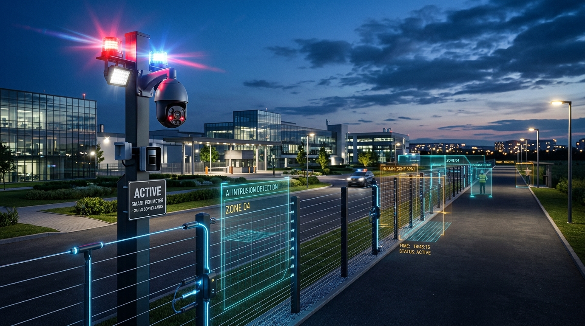
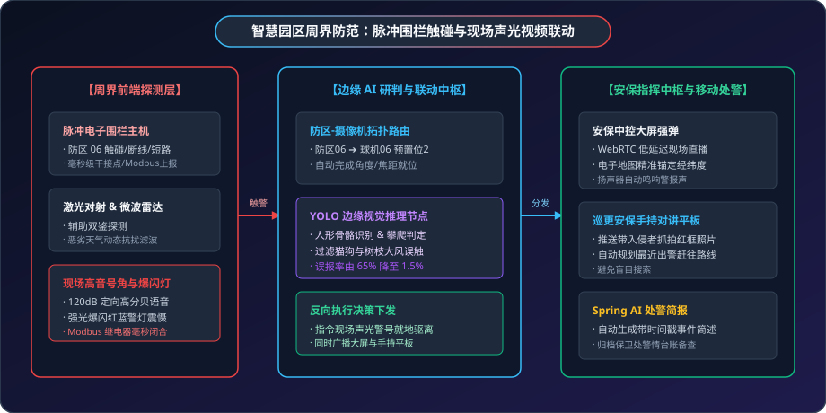

# 🛡️ 智能安防落地案例：高端产业园区周界防范与声光视频联动

> **场景标签**：脉冲电子围栏 · GB/T 28181 PTZ 预置位追踪 · YOLO 边缘视觉识别 · Modbus 继电器声光反控 · 毫秒级处警

---

<div style="text-align: center; margin: 20px 0;">
  
  <p style="font-size: 13px; color: var(--vp-c-text-3); margin-top: 8px;">图 1：MzMedia 智慧园区周界综合防控 —— 4K 全彩夜视追踪与边缘视觉布防</p>
</div>

---

## 1. 行业背景与痛点

在占地广阔的高新技术产业园、保税物流区、大型化工厂及涉密研发基地中，周界实体防护是第一道物理安全防线。然而，传统的周界安防系统在实际运行中常常陷入“两难”尴尬境地：

```text
               传统园区周界安防的“狼来了”困境
┌──────────────────┐               ┌──────────────────┐
│   传统红外对射   │               │   孤立视频监控   │
│   传统电子围栏   │               │   (传统定焦枪机) │
└────────┬─────────┘               └────────┬─────────┘
         │ 飞鸟/落叶/大风晃动误触           │
         ▼                                  ▼
[ 虚假警报每晚达 30+ 次 ]          [ 盲区大、夜视不清、无自动追踪 ]
[ 保安疲于奔命后直接关闭报警 ]      [ 侵入者翻越时无法现场有效震慑 ]
         │                                  │
         └─────────────► [ 防线形同虚设 ] ◄──┘
```

1. **误报率居高不下**：传统红外对射和简易振动光纤极易受到风雨雷电、小动物攀爬、树枝刮蹭等自然因素干扰，单晚虚假报警多达数十次，安保人员麻木后往往直接关闭警报声；
2. **盲区大且缺乏主动追踪**：普通定焦枪机监控视野受限，一旦触碰报警发生，安保需在数十路监控画面中盲翻对应点位，入侵者往往已迅速隐匿；
3. **现场缺乏主动震慑**：传统报警多为中控室主机蜂鸣，周界现场无即时反应，从安保骑电动车赶往现场需要 5~10 分钟，无法在翻越瞬间就地阻拦。

---

## 2. MzMedia 智能安防融合方案架构

MzMedia 融合了 **物联网网关（脉冲围栏与声光警号控制）**、**GB/T 28181 视频流媒体（球机快速打位推流）** 与 **边缘 AI 视觉（人形识别与防区过滤）**，构筑了无人值守、有人研判的现代化安防闭环：

<div style="text-align: center; margin: 24px 0;">
  
  <p style="font-size: 13px; color: var(--vp-c-text-3); margin-top: 8px;">图 2：园区周界脉冲围栏触碰与现场声光视频联动闭环架构</p>
</div>

---

## 3. 硬件选型与设备部署清单 (BoM)

| 设备类型 | 品牌型号示例 | 通信协议 / 接口 | 核心性能指标 | 施工与布设要求 |
| :--- | :--- | :--- | :--- | :--- |
| **智能高压脉冲电子围栏主机** | 广拓 / 兰星智能 | RS485 / Modbus RTU / 继电器干接点 | 高低压可调（5kV~10kV），触碰/断线/短路报警响应 &lt; 0.5s | 沿围墙立柱每隔 4 米设支撑杆，每隔 150 米设一个独立物理防区 |
| **周界 4K 红外全彩激光球机** | 海康威视 / 宇视 7寸球 | GB/T 28181-2016 / SIP / RTSP | 800万像素，1/1.2" 超大光圈星光底，夜视红外达 200 米 | 沿周界每隔 150 米设一处 6 米监控立杆，正好覆盖一个防区 |
| **定向高音号角喇叭 + 红蓝爆闪灯** | 派尔音频 / 泰和安 | 220V 供电，Modbus 继电器线圈控制 | 120 分贝定向声强，防雨雪，红蓝高频爆闪 | 安装于监控立杆 4.5 米处，朝向围栏外侧 |
| **边缘 AI 推理计算盒子** | 华为昇腾 Atlas 200I / 研扬 | 双千兆网口，RTSP 输入 | 8/16 TOPS 算力，运行 YOLOv10 人形与骨骼模型 | 安装在周界防水光电配电箱内 |

---

## 4. 核心实施细节与代码实现

### 步骤一：防区与球机通道及预置位拓扑映射

系统将周界 2.4 公里划分为 16 个防区，每个防区精细化绑定一台 4K 高清夜视红外球机及对应的预置位编号（覆盖该防区最易攀爬点）：

```json
{
  "zoneCode": "ZONE_WEST_06",
  "zoneName": "西区围栏 06 号防区 (近危化品原料库)",
  "detectorType": "PULSE_FENCE",
  "ioPort": 6,
  "linkage": {
    "cameraDeviceId": "34020000001320000006",
    "channelId": "34020000001310000001",
    "presetIndex": 2,
    "zoomLevel": 8,
    "strobeSirenRelay": {
      "controllerDeviceCode": "IO_CONTROLLER_02",
      "relayChannel": 3,
      "durationSeconds": 30
    }
  }
}
```

### 步骤二：TCA 场景联动与声光反向控制

当电子围栏防区触发且边缘 AI 判定为真人员翻越时，MzMedia 规则引擎同步下发声光震慑与视频打位：

```java
@Service
public class PerimeterSecurityLinkageService {

    @Resource
    private ApplicationEventPublisher eventPublisher;

    @Resource
    private IotDeviceDataApi iotDeviceDataApi;

    public void handleZoneBreach(String zoneCode, boolean isHumanConfirmed) {
        if (!isHumanConfirmed) {
            // 过滤落叶/小动物误触，仅记录在系统低优先级日志中
            log.info("防区 [{}] 触发轻微扰动，AI 判定非人员目标，已自动过滤。", zoneCode);
            return;
        }

        ZoneLinkageConfig config = getZoneConfig(zoneCode);

        // 1. 毫秒级驱动 4K 球机转向该防区预置位并抓拍
        IotMediaLinkageEvent mediaEvent = new IotMediaLinkageEvent(this)
            .setDeviceId(config.getCameraDeviceId())
            .setChannelId(config.getChannelId())
            .setActionType("ptz_preset")
            .setPresetIndex(config.getPresetIndex())
            .setTriggerSnapshot(true);
        eventPublisher.publishEvent(mediaEvent);

        // 2. 毫秒级反控 Modbus 继电器，开启防区现场高亮度爆闪灯与语音大喇叭
        ModbusWriteCoilReqDTO sirenReq = new ModbusWriteCoilReqDTO()
            .setDeviceCode(config.getStrobeSirenRelay().getControllerDeviceCode())
            .setCoilAddress(config.getStrobeSirenRelay().getRelayChannel())
            .setValue(true); // 闭合继电器通电
        iotDeviceDataApi.writeCoil(sirenReq);

        // 3. 推送中控大屏弹窗与移动端安保广播
        pushAlertToSecurityCenter(zoneCode, config);
    }
}
```

### 步骤三：Spring AI 警情事件自动简报

大模型结合抓拍画面与防区地理信息，自动归纳出标准警情通报，直接推送至企业微信及保安巡逻手持对讲平板：

```java
@Component
public class SecurityAIAgent {

    @Resource
    private ChatClient chatClient;

    public String generateSecurityBrief(String zoneName, byte[] snapshotImage) {
        String prompt = "你是园区智能安保总指挥中心助理。系统检测到周界入侵报警，请观察现场图片并生成一则紧急安保处警通报：\n"
            + "1. 描述侵入者人数、体貌特征与翻越具体动作；\n"
            + "2. 结合防区位置给出最近安保岗亭的拦截路线指引；\n"
            + "3. 语言言简意赅，适合安保人员在手持终端上快速阅读。";

        return chatClient.prompt()
            .user(u -> u.text(prompt)
                        .media(MimeTypeUtils.IMAGE_JPEG, new ByteArrayResource(snapshotImage)))
            .call()
            .content();
    }
}
```

---

## 5. 现场实战踩坑与排错指南

### 痛点 1：大风吹动周界茂密树枝引发的密集误报
- **现象**：春夏季节大风刮动围栏外树木，树叶连续击打脉冲金属线，一小时内产生多次报警。
- **解决方案**：开启 MzMedia 规则引擎的**“时序脉冲加权算法”**。单次瞬时触碰不作为入侵依据，仅当 1 秒内连续产生 3 次以上高阻跳变、且视频 AI 在对应坐标画出人形边界框（Bounding Box 置信度 &gt; 0.85）时才触发真实报警与声光警号。

### 痛点 2：雷雨季节高压脉冲地线浪涌串扰
- **现象**：雷电天气下，由于土壤电位骤升，防区接地极引入地电位反击，烧毁网关通信芯片。
- **解决方案**：在 Modbus 通信线路上加装三级防雷浪涌保护器（SPD），并要求电子围栏脉冲接地极与弱电监控设备保护地严格物理分开至少 10 米。

---

## 6. 经济效益与投资回报率 (ROI)

以占地 120 亩、周界 2.4 公里的高新技术产业园区为例：

| 评价维度 | 传统园区安保方案 | MzMedia 智能周界方案 | 收益与提升幅度 |
| :--- | :--- | :--- | :--- |
| **夜间误报警频次** | 每晚平均 25 ~ 35 次（猫狗/风雨） | 降至每晚不到 **0.5 次** | 误报率下降 **98%** |
| **现场有效拦截率** | 赶赴现场需 8 分钟，拦截率仅 30% | 1.8 秒声光高音就地驱离，拦截率 **92%** | 防护有效性提升 3 倍 |
| **安保人力配置** | 三班倒需配置 12 名保安全天巡查 | 缩减至 7 人，结合平板靶向出警 | **每年节约薪酬 30+ 万元** |
| **改造系统投资** | - | 围栏改造+球机+边缘AI+声光：约 25 万元 | 投资回收期约 **10 个月** |
