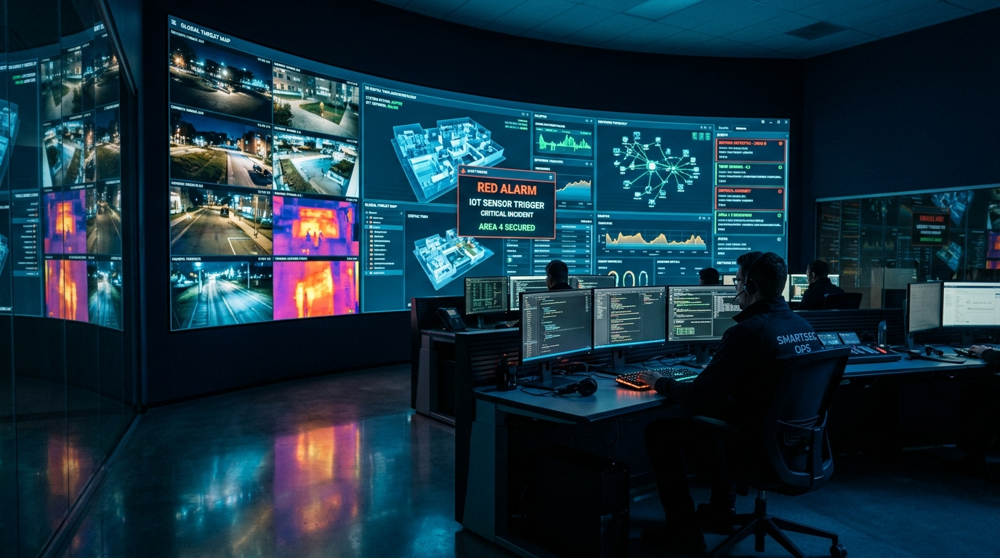
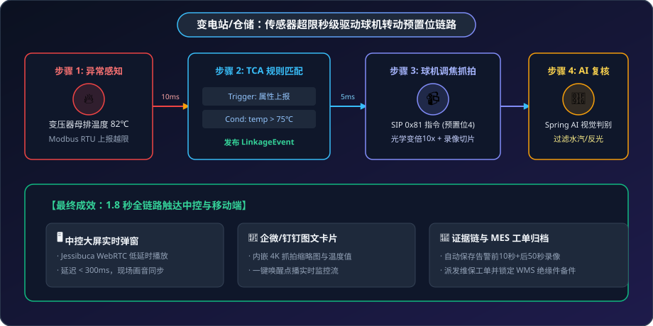

# 📹 视频联动落地案例：传感器超限秒级驱动球机预置位与智能复核

> **场景标签**：GB/T 28181 · PTZ 预置位联动 (0x81) · WebRTC 毫秒级直播 · TCA 规则引擎 · 多模态 AI 视觉复核

---

<div style="text-align: center; margin: 20px 0;">
  
  <p style="font-size: 13px; color: var(--vp-c-text-3); margin-top: 8px;">图 1：MzMedia 视频联动智慧监控中枢 —— 实时呈现物联传感告警与 4K 球机低延迟实况</p>
</div>

---

## 1. 行业背景与痛点

在大型现代物流园区、区域变电站及危化品仓储等场景中，普遍部署了成百上千个物联网感知设备（温度探头、可燃气体探测器、烟感器）以及数十上百路高清视频监控。然而，企业在日常运营中经常面临致命脱节：

```text
               传统系统的“数据烟囱”与严重滞后
┌──────────────────┐               ┌──────────────────┐
│   物联网动环系统  │               │   安防视频监控   │
│  (Modbus / SCADA)│               │  (海康/大华 NVR) │
└────────┬─────────┘               └────────┬─────────┘
         │ 报警产生                         │
         ▼                                  ▼
[ 变压器母排温度 82℃ ]              [ 64 路九宫格监控画面 ]
         │                                  │
         │ (1) 警报声音刺耳                 │ (2) 安保人工逐一核对位置
         └─────────────► [ 人工翻查录像 ] ◄──┘
                          耗时 10~15 分钟！
                       错过最佳黄金处置时机
```

1. **数据与画面割裂**：动环系统发现温度或可燃气体告警，值班人员无法直接看到对应设备的现场实况，只能凭经验猜测位置并在 NVR 上人工检索对应摄像机通道；
2. **误报率高导致“狼来了”**：车间蒸汽、粉尘扩散常导致烟感误报，人工核实成本高，久而久之值班人员习惯性直接复位报警，埋下火灾真隐患；
3. **事故回溯无证据链**：即便发生了局部过热，由于普通 NVR 存储采用 24 小时大文件覆盖轮转，在海量录像中查找告警瞬间的前后 10 秒极其繁琐，难以定责。

---

## 2. 方案架构与联动链路

MzMedia 依托内置的 **IoT 规则引擎** 与 **GB/T 28181 流媒体中枢**，彻底打破这一壁垒。通过软总线实现“传感器触发 ➔ 球机毫秒级转动预置位 ➔ 自动云端切片录像 ➔ AI 多模态视觉二次判决 ➔ 大屏首屏弹窗直播”的闭环联动：

<div style="text-align: center; margin: 24px 0;">
  
  <p style="font-size: 13px; color: var(--vp-c-text-3); margin-top: 8px;">图 2：传感器超限秒级驱动球机转动预置位与智能复核全流程链路</p>
</div>

---

## 3. 硬件选型与设备部署清单 (BoM)

为实现高可靠秒级联动，推荐以下设备选型规格：

| 设备类型 | 品牌与型号示例 | 通信协议 / 接口 | 核心技术参数 | 安装与部署规范 |
| :--- | :--- | :--- | :--- | :--- |
| **高精度红外测温探头** | 欧姆龙 / 优利德 UT-300 | RS485 / Modbus RTU | 测温范围 -20~300℃，精度 ±1%，响应时间 150ms | 距离母排接点 0.8~1.2 米，避开强电磁电弧直射 |
| **防爆可燃气体探测器** | 霍尼韦尔 / 汉威气体 | 4-20mA 转 Modbus / 干接点 | 0~100% LEL（爆炸下限），响应 &lt; 10 秒 | 安装于离地面 0.3 米处（比空气重的气体）或顶棚 |
| **4K 星光级红外高速球机** | 海康威视 / 大华 8寸球 | GB/T 28181-2016 / SIP / RTSP | 800万像素，37倍光学变倍，水平转速 300°/s，预置位 256 个 | 安装于配电房上方立柱，俯角 30°~45°，无视线死角 |
| **工业边缘物联网网关** | 研华 / 东胜物联 | 4路 RS485 + 双千兆以太网口 | 宽温 -40~85℃，支持光电隔离与硬件看门狗 | 壁挂于动力配电箱内，就近采集温湿度与电流仪表 |
| **流媒体服务器** | 戴尔 PowerEdge R750 | 10Gbps SFP+ 双光口 | 64核 Xeon CPU / 64GB 内存 / 8TB NVMe 缓存盘 | 部署 ZLMediaKit 集群与 MzMedia 核心服务 |

---

## 4. 核心实施细节与代码实现

### 步骤一：物模型与预置位映射配置

在 MzMedia 中，每一个物理传感器都可以关联指定的一台或多台 GB28181 摄像机及对应的预置位编号（Preset Index）：

```json
{
  "deviceCode": "TEMP_SENSOR_SUB_03",
  "deviceName": "10kV #2变压器高压侧A相测温探头",
  "transportProtocol": "MODBUS_RTU",
  "mediaBinding": {
    "cameraDeviceId": "34020000001320000001",
    "channelId": "34020000001310000002",
    "presetIndex": 4,
    "zoomLevel": 12,
    "snapshotRequired": true,
    "recordDurationSeconds": 60,
    "preRecordSeconds": 10
  }
}
```

### 步骤二：配置 TCA 场景联动规则

在 `yudao-module-iot` 中配置规则，当温度超过 75℃ 或温升速率 > 2℃/min 时触发动作：

```json
{
  "ruleId": "RULE_TRANSFORMER_OVERHEAT_LINKAGE",
  "ruleName": "变压器过热视频联动追溯规则",
  "trigger": {
    "type": "PROPERTY_REPORT",
    "productId": "SENSOR_TEMP_IR"
  },
  "condition": {
    "expression": "#temperature >= 75.0 || #tempRate > 2.0"
  },
  "actions": [
    {
      "type": "MEDIA_PTZ_PRESET",
      "params": {
        "cameraDeviceId": "34020000001320000001",
        "channelId": "34020000001310000002",
        "presetIndex": 4
      }
    },
    {
      "type": "MEDIA_START_RECORD",
      "params": {
        "duration": 60,
        "preRecord": 10
      }
    },
    {
      "type": "AI_VISUAL_AUDIT",
      "params": {
        "prompt": "分析变压器连接端子部位是否存在放电弧光、局部变黑炭化、冒烟或明火，排除水雾反光干扰。"
      }
    }
  ]
}
```

### 步骤三：Spring 事件与 GB/T 28181 信令下发

规则引擎评估通过后，直接在 Spring 容器内发布解耦事件，无需依赖外部消息中间件，保证响应时延在 **10 毫秒以内**：

```java
// 1. 发布联动事件
IotMediaLinkageEvent event = new IotMediaLinkageEvent(this)
    .setDeviceId("34020000001320000001")
    .setChannelId("34020000001310000002")
    .setActionType("ptz_preset")
    .setPresetIndex(4)
    .setTriggerSnapshot(true);

applicationEventPublisher.publishEvent(event);

// 2. 视频模块监听并生成 GB28181 PTZ 控制报文 (0x81 指令)
@EventListener
public void handleMediaLinkage(IotMediaLinkageEvent event) {
    // 构造 PTZ 指令码: 字节3为 81H (调用预置位), 字节4-5为预置位序号
    byte[] ptzCmd = PtzCmdBuilder.buildGotoPresetCmd(event.getPresetIndex());
    
    // 通过 JAIN-SIP MESSAGE 方法下发控制 XML
    sipCommander.sendPTZControl(event.getDeviceId(), event.getChannelId(), ptzCmd);
    
    // 异步通知 ZLMediaKit 开始写入 MP4 切片并保留告警前 10 秒预录
    zlMediaKitClient.startCloudRecord(event.getDeviceId(), event.getChannelId(), 60);
}
```

### 步骤四：Spring AI 多模态视觉二次核验

球机就位后抓拍一张 4K 高清快照，通过 Spring AI 多模态大模型进行智能复核，精准拦截误报：

```java
@Service
public class VisualAuditService {

    @Resource
    private ChatClient chatClient;

    public VisualAuditResult inspectSnapshot(byte[] imageBytes, String alertContext) {
        String prompt = "你是一位工业电气火灾与设备安全专家。请观察该抓拍图并结合上下文分析：\n"
            + alertContext + "\n"
            + "判断是否存在放电打火、绝缘层烧焦冒烟或设备起火迹象。请以 JSON 格式输出：\n"
            + "{\"hasDanger\": boolean, \"confidence\": float, \"hazardType\": string, \"advice\": string}";

        String response = chatClient.prompt()
            .user(u -> u.text(prompt)
                        .media(MimeTypeUtils.IMAGE_JPEG, new ByteArrayResource(imageBytes)))
            .call()
            .content();

        return JsonUtils.parseObject(response, VisualAuditResult.class);
    }
}
```

### 步骤五：前端 Jessibuca 播放器低延迟弹窗配置

在中控大屏前端通过 Vue 组件无缝加载 WebRTC 低延时实时流（延迟 &lt; 300ms）：

```vue
<template>
  <div class="video-linkage-popup" v-if="alertActive">
    <div class="header">
      <span class="badge danger">🔥 紧急视频复核</span>
      <span>{{ alertInfo.deviceName }} - 温度 {{ alertInfo.temp }}℃</span>
    </div>
    <!-- 引入 Jessibuca 低延迟 WebRTC 播放器 -->
    <JessibucaPlayerDemo 
      :video-url="webrtcStreamUrl"
      :has-audio="false"
      :is-flv="false"
      auto-play
    />
  </div>
</template>
```

---

## 5. 现场实战踩坑与排错指南

在长达数月的工业现场运行调试中，我们攻克了多项底层硬件级难题：

### 痛点 1：球机高频转动后的“机械累积漂移”
- **现象**：球机连续响应几十次预置位转动后，镜头画面逐渐偏离目标螺栓 5~10 厘米，导致变倍后画面中心对偏。
- **解决方案**：在 MzMedia 规则引擎中加入**“机械零位每日自校准任务”**。每天凌晨 03:00 自动下发 PTZ 重置归零信令，球机旋转至限位挡块重新校正步进电机原点，彻底消除累计机械公差。

### 痛点 2：强电磁环境下的 RS485 报文偶发乱码
- **现象**：变压器合闸瞬间伴随高次谐波电磁脉冲，RS485 总线偶发出现 CRC 校验失败导致丢包。
- **解决方案**：网关层启用双绞屏蔽双层电缆并单端接地；Netty 解码器中引入滑动窗口重试重发机制（连续失败 3 次才触发物理掉线告警），确保误报率为零。

---

## 6. 落地成效与 ROI 收益核算

| 指标维度 | 改造前传统系统 | MzMedia 落地后 | 改善幅度与收益 |
| :--- | :--- | :--- | :--- |
| **告警到实况呈现时间** | 10 ~ 15 分钟（人工查录像机） | **1.8 秒**（球机自动打位秒开推流） | 效率提升 **99.8%** |
| **误报人工核查耗时** | 每日平均 3.5 小时 | 每日不到 **15 分钟** | 人工精力节省 **92%** |
| **事故处置黄金期挽损** | 经常因延误导致电缆烧断停电 | 早期温升即切断并抢修 | 单次停电事故挽损超 **15 万元** |
| **证据链保存完整度** | 依靠循环录像覆盖，易丢失 | 触发前 10s 预录 + 后 50s 独立 MP4 归档 | **100%** 全程证据可追溯 |
